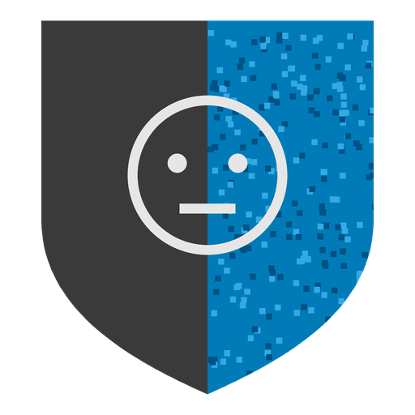
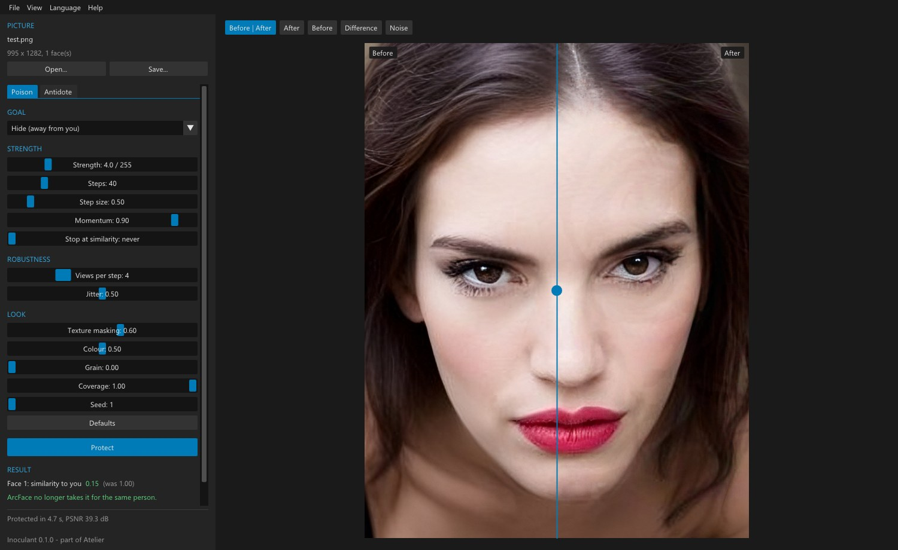
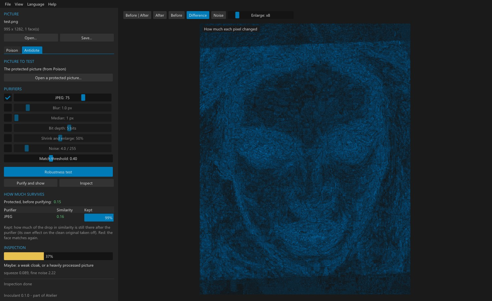

[](https://x.com/NorowaretaGemu)
[](https://opensource.org/licenses/MIT)

<br>
<div align="center">
  <a href="https://ko-fi.com/cursedentertainment">
    
  </a>
</div>
<br>
<div align="center">
  
  
  
  
</div>
<div align="center">
  
  
  
</div>
<br>

<div align="center">
  
</div>

# Inoculant

**Poisons and antidotes for your own pictures.** Inoculant puts an almost invisible cloak on the faces in a photo
of you, so face recognisers, and the face swappers and identity editors built on them, stop reading it as you. Then
it washes the protected picture the ways other people might (JPEG, blur, resizing...) and tells you how much of the
protection survives, or inspects any picture for signs of a cloak. Pure C++, on your own PC: no Python, a GPU through
DirectML (NVIDIA, AMD or Intel), or the CPU. Part of **[Atelier](https://github.com/CursedPrograms/Atelier)**,
Cursed Entertainment's creative suite. **[Website](https://cursedprograms.github.io/Inoculant/)**



> **A protective tool.** Use Inoculant on pictures of yourself, or of people who agreed. It is meant to protect
> your own media, and to test how well that protection holds; don't use it to hide or forge anyone else's identity.
> A cloak is a speed bump, not a guarantee: recognisers it hasn't seen, or ones trained later, may see through it.

## What it does

### Poison: the identity cloak
- **Projected gradient descent** (PGD) with **momentum** (MI-FGSM) against **ArcFace** (InsightFace's w600k_r50),
  the face recogniser most face swappers (inswapper, SimSwap, HyperSwap) and many identity adapters use to read
  "who this is". Each pixel may change by at most the **strength** you choose (2-4 levels of 255 is hard to see).
- **Two goals:** *Hide* pushes the face's identity away from yours; *Decoy* pulls it toward another face (use an
  AI-generated one), so a swap made from your photo comes out as somebody who doesn't exist.
- **Robust by design:** every step looks at the face through several jittered views (Expectation over
  Transformation: small shifts, turns, scalings and blurs), so the cloak survives re-alignment, resizing and JPEG.
- **Every parameter is a slider** with a tooltip: strength, steps, step size, momentum, stop-at-similarity, views
  per step, jitter, texture masking (more change in hair and texture, less on smooth skin), colour (light/dark only
  vs. full colour), grain, coverage, seed.
- **The view:** the picture in the middle with a **wipe** between before and after (drag it on the picture), or the
  **difference as a heat-map**, or **the noise itself**, enlarged round grey. Keys 1 wipe, 2 after, 3 before,
  4 difference, 5 noise.

### Antidote: how much survives
- **Purifiers**, each with a strength slider: JPEG quality, Gaussian blur, median filter, bit-depth reduction,
  shrink-and-enlarge, added noise (the input-transformation defences collected in IBM's Adversarial Robustness
  Toolbox).
- **Robustness test:** each purifier on the protected picture *and* on the original; ArcFace's similarity to the
  original face, and how much of the protection is **kept** (the purifier's own effect taken off).
- **Inspect:** no original needed. Feature squeezing as a detector: a clean face's identity hardly moves when the
  picture is squeezed, a cloaked one jumps. NightshadeAntidote's idea of looking at the high frequencies is shown as
  a second number.
- **Purify and show** puts the purified picture after the wipe, to compare and save.



## How it works without Python

ONNX Runtime only runs models forwards, but a cloak needs the gradient: which way each pixel should move to change
what the recogniser sees. So Inoculant **reads ArcFace's .onnx file itself and writes a second graph that also runs
it backwards** (reverse-mode differentiation written out op by op: Conv becomes ConvTranspose, PReLU a Where,
BatchNormalization a scale, Gemm a MatMul), with the cosine-similarity loss on top. It does this once, in C++, on
your PC (`w600k_r50_grad.onnx`, next to the model), and it agrees with finite differences:

```
inoculant-cli grad-check
direction 0: finite difference -0.000169, gradient graph -0.000172
direction 1: finite difference +0.000373, gradient graph +0.000378
along the gradient: finite difference +0.076521, |gradient| +0.075560
```

Each step's gradients on the 112 x 112 face crops are carried back onto the picture's own pixels through the exact
adjoint of the alignment warp, so the cloak is made at full resolution. `tools/make_grad.py` is the same builder in
Python, for reference (development only).

## Tested

On AI-generated test faces only (Changeling's test personas, and an AI face from Mosaic-Mask as the decoy), default
settings (strength 4, 40 steps, 4 views), on the GPU through DirectML:

| Picture | Time | PSNR | ArcFace similarity to the original |
|---|---|---|---|
| test.png (995 x 1282) | 6 s | 39.3 dB | **1.00 -> 0.15** |
| test2.png | 5 s | 40.7 dB | 1.00 -> 0.18 |
| test-small.png | 5 s | 40.5 dB | 1.00 -> 0.15 |

0.40 is about where face swappers and face search start to match the same person. Strength 8 reaches -0.58.

Robustness of test.png's cloak (strength 4) against strong purifiers:

| Purifier | Similarity after | Kept |
|---|---|---|
| JPEG quality 50 | 0.17 | 98% |
| Blur 2 px | 0.18 | 97% |
| Median 2 px | 0.16 | 98% |
| Bit depth 4 | 0.27 | 83% |
| Shrink to 25% and back | 0.18 | 96% |
| Noise 8 / 255 | 0.17 | 98% |
| **All six in a row** | **0.38** | **70%** |

Decoy (toward a different AI face): strength 4 meets halfway (0.54 to the original, 0.54 to the decoy);
strength 8 gives 0.14 to the original and 0.77 to the decoy.

Inspect: clean pictures squeeze 0.04-0.07 (score 0-10%); strength-4 cloaks 0.09 ("maybe", about 40%); strength 8,
0.17 ("likely cloaked"). A light cloak can hide from the inspector; that's the point of a light cloak.

**Not tested yet:** other face recognisers (the cloak is made against ArcFace w600k_r50; how well it carries over to
other models is the next thing to measure), and model training or fine-tuning (see Planned).

## Install

Download **Inoculant-win64.zip** from [Releases](https://github.com/CursedPrograms/Inoculant/releases), unzip it
and run `install.bat` (or `install.ps1`) beside it: it goes to `%LOCALAPPDATA%\Programs\Inoculant` with Start menu
and Desktop shortcuts. Or run `Inoculant.exe` where it is. Linux: `build.sh`, then `install.sh`.

The models aren't in the download: ArcFace and the face finders are fetched once from
[FaceFusion's model releases](https://github.com/facefusion/facefusion-assets/releases) into
`%APPDATA%\Atelier\models` (or `F:\AIModels\face` when that folder exists), unless they're already there.

## The command line

```
inoculant-cli protect in.jpg out.png [--strength 4] [--steps 40] [--step 0.5] [--momentum 0.9] [--samples 4]
              [--robustness 0.5] [--smoothness 0] [--texture 0.6] [--colour 0.5] [--coverage 1] [--stop-at -1]
              [--decoy face.jpg] [--seed 1] [--cpu]
inoculant-cli test clean.jpg protected.png [--jpeg 75] [--blur 1] [--median 1] [--bits 5] [--resize 50] [--noise 4] [--all]
inoculant-cli purify in.png out.png [the same purifiers]
inoculant-cli inspect picture.jpg
inoculant-cli grad-check
```

The window: `Inoculant [picture]`. For tests, `Inoculant --capture shot.bmp [--protect] [--test] [--inspect]
[--purify] [--tab antidote] [--view 0-4] [--lang ja] picture.png` saves a screenshot and quits.

## Languages

English, and packs for Japanese, Chinese, Spanish, Korean, French, German, Russian, Serbian, Afrikaans, Yucatec Maya
and Pennsylvania Dutch (the Language menu). The packs are in `lang/`, made by `lang/make_packs.py`; the longer
tooltips are still English.

## Build

Windows: Visual Studio 2022 (C++) and CMake, then `build.bat` (or `build.ps1`). SDL2 and ONNX Runtime with DirectML
are fetched into `external/` once; the result is `build/Release/` and `dist/Inoculant-win64.zip`, and an installed
Inoculant is updated.

The code, in `src/`:
- `gradgraph.cpp`: reads an ONNX model and writes its gradient graph (a small protobuf reader/writer)
- `cloak.cpp`: the identity cloak (PGD, MI-FGSM, EOT, the warp's adjoint, the budget maps)
- `antidote.cpp`: the purifiers, the robustness test, the inspector
- `faces.cpp`, `image.h`, `ort.cpp`: face finding and alignment, ONNX Runtime (shared with Mimic)
- `gui.cpp`, `splash.cpp`, `lang.cpp`: the window, its splash, the language packs; `cli.cpp`: `inoculant-cli`

## Planned

- **Training cloak** (Glaze / Nightshade / Mist / PhotoGuard style): the same gradient-graph trick on Stable
  Diffusion's VAE encoder, so whole pictures (art, not only faces) resist fine-tuning and img2img. Needs the graph
  builder to learn GroupNorm, SiLU, attention and Pad.
- **Transfer test:** a second recogniser in the Antidote tab, to measure how far a cloak made against one model
  carries to another; ensembles in the cloak.
- **Swap test:** run a face swap from the protected picture (through Mimic) and show it next to one from the original.
- **Video:** the cloak on every frame of a video. Frames protected one by one flicker, so the change is carried from frame
  to frame (each frame starts from the last one's cloak, following the face) and smoothed over time. Video encoding
  washes off more than a PNG does, so it needs a high-quality encode and the Robustness setting up; expect less
  protection than on a still. Then Mimic's and Mosaic Mask's video output get it too.
- **Deepfake disruption** against image-translation models (after Ruiz et al.'s disrupting-deepfakes).
- **Diffusion purification** in Antidote (the strongest known wash), and batches of folders.
- **Text and agent modules** (later): font-level text protection after shieldfont, anti-scraper text after miasma,
  agent-memory poisoning checks after OWASP's Agent Memory Guard. shieldfont (AGPL-3.0) and miasma (GPL-3.0) can't be
  copied into this MIT project, so those would be written fresh from their ideas or run as separate programs.

## Credits

Methods from Madry et al. (PGD), Dong et al. (MI-FGSM), Athalye et al. (EOT), Xu et al. (feature squeezing),
[IBM's Adversarial Robustness Toolbox](https://github.com/Trusted-AI/adversarial-robustness-toolbox),
[disrupting-deepfakes](https://github.com/natanielruiz/disrupting-deepfakes) and
[NightshadeAntidote](https://github.com/RichardAragon/NightshadeAntidote); Inoculant is its own C++ code.
ArcFace and the face detector are [InsightFace](https://github.com/deepinsight/insightface)'s (models for
non-commercial research use). Built with [ONNX Runtime](https://github.com/microsoft/onnxruntime), DirectML,
[SDL2](https://www.libsdl.org), [Dear ImGui](https://github.com/ocornut/imgui) and [stb](https://github.com/nothings/stb).
See [NOTICE](NOTICE).

[Farica☆Kimora](https://github.com/Farica-Kimora) © Cursed Entertainment

<br>
<div align="center">
© Cursed Entertainment 2026
</div>
<br>
<div align="center">
<a href="https://cursed-entertainment.itch.io/" target="_blank">
    
</a>
</div>
